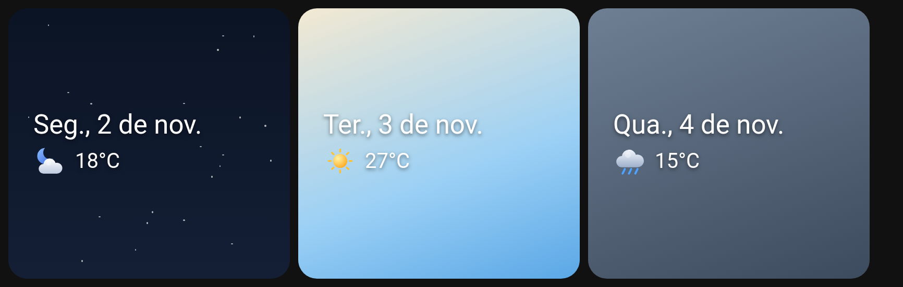

# Glance Clima

Widget de tela inicial para Android com **data** e **clima atual**, em fundo transparente:
uma linha grande com a data (`Seg., 2 de nov.`) e, logo abaixo, um ícone do clima com a
temperatura (`18°C`). Texto branco, fonte sans-serif e sombra suave para ler bem sobre
qualquer papel de parede.



> Projeto independente e original: todo o código e todos os ícones foram escritos do zero.
> Ele não usa código, imagens ou ícones do Google (Pixel Launcher / "Visão rápida").

## Recursos

- Data curta em pt-BR (`Seg., 2 de nov.`), que vira sozinha à meia-noite.
- Clima atual pela [Open-Meteo](https://open-meteo.com/) (gratuita, **sem chave de API**).
- 9 ícones vetoriais próprios, com visual 3D suave: sol, lua, nuvem, parcialmente nublado
  (dia e noite), chuva, tempestade, neblina e neve. Dia/noite vem do campo `is_day` da API.
- Atualização automática a cada ~30 minutos (WorkManager).
- Toque na **data** → abre o app de calendário. Toque no **clima** → atualiza na hora.
- Redimensionável: o texto e o ícone se ajustam ao tamanho do widget.
- Local: localização aproximada (permissão `ACCESS_COARSE_LOCATION`), **São Paulo** como
  padrão, ou digite o nome de uma cidade (geocodificação da Open-Meteo).

## Como usar

1. Instale o APK (`app-debug.apk`) e abra o app **Glance Clima** uma vez para escolher o local
   (ou escolha na hora em que adicionar o widget).
2. Segure a tela inicial → **Widgets** → **Glance Clima** → arraste para a tela.
3. Para trocar o local depois: segure o widget e use a opção de configurar/reconfigurar,
   ou abra o app pelo ícone.

## Compilar

Requisitos: JDK 17 e Android SDK (plataforma 36 e build-tools 36).

```bash
echo "sdk.dir=/caminho/do/android-sdk" > local.properties
./gradlew assembleDebug
# APK em app/build/outputs/apk/debug/app-debug.apk
```

O APK de debug já sai assinado com a chave de debug do Android, então pode ser instalado
direto (`adb install -r app-debug.apk` ou pelo gerenciador de arquivos).

## Estrutura

```
app/src/main/java/com/igorbarros/glanceclima/
  GlanceWidgetProvider.kt   AppWidgetProvider + RemoteViews, cliques e alarme da meia-noite
  WeatherWorker.kt          WorkManager (periódico de 30 min e atualização imediata)
  WeatherApi.kt             Open-Meteo: clima atual e busca de cidades
  WeatherIcons.kt           código WMO + is_day → ícone
  DateFormatter.kt          data curta em pt-BR
  SetupActivity.kt          configuração de local (GPS aproximado / cidade / padrão)
  CalendarActivity.kt       abre o calendário ao tocar na data
  Prefs.kt                  local e último clima salvos
app/src/main/res/drawable/ic_w_*.xml   ícones de clima (VectorDrawable)
tools/gen_icons.py          gera os VectorDrawables e SVGs dos ícones
tools/render_preview.py     gera a imagem de pré-visualização (precisa do Chrome)
```

## Limitações

- A localização é lida só quando você toca em "Usar minha localização" (sem permissão de
  localização em segundo plano); as coordenadas ficam salvas até você trocar. Se você viajar,
  atualize o local pelo app.
- A atualização a cada 30 min é feita pelo sistema e pode atrasar com economia de bateria.
- O widget mostra apenas o clima atual (sem previsão e sem eventos da agenda).
- Em Androids anteriores ao 12, o tamanho do ícone não acompanha o redimensionamento do widget.

## Privacidade

O app só envia latitude/longitude (aproximadas) à Open-Meteo para obter o clima, e o texto
digitado na busca de cidade. Nada é enviado a outros servidores e não há anúncios nem
rastreamento.

## Licença

[MIT](LICENSE) © 2026 Igor Barros. Dados meteorológicos por [Open-Meteo](https://open-meteo.com/)
(CC BY 4.0, uso não comercial).
